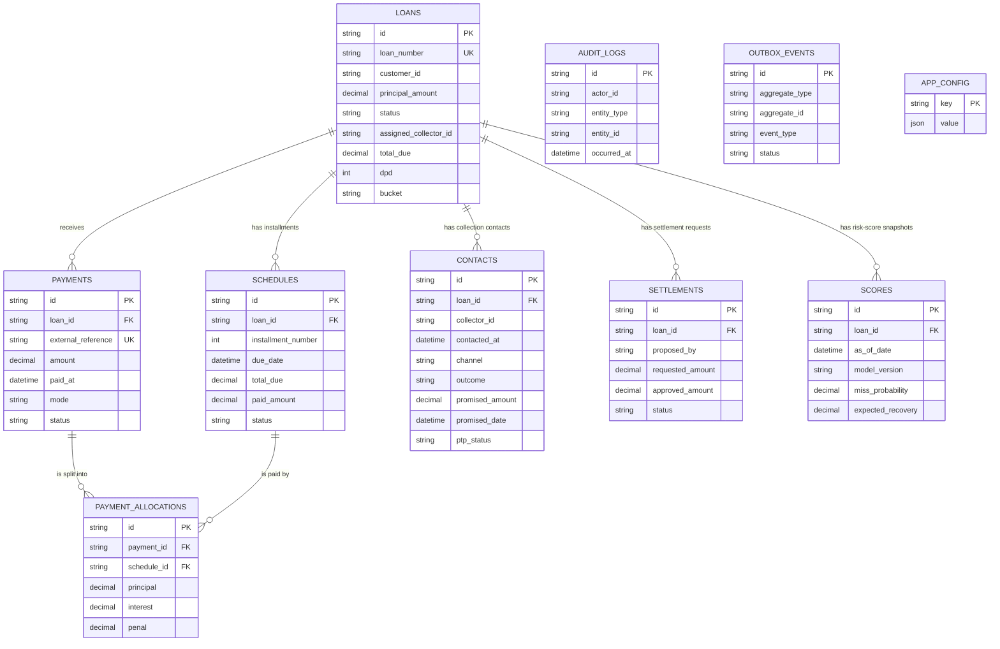

# RecoverPlus database ER diagram

This diagram reflects the PostgreSQL schema in `prisma/schema.prisma` and the
initial migration. `PK` means primary key and `FK` means foreign key.

`AuditLog`, `OutboxEvent`, and `AppConfig` are included in the diagram as
standalone tables because the current database migration defines no foreign keys
from them to the business tables.

## Enforced relationships

| Relationship | Cardinality | Foreign key and delete behavior | Example |
| --- | --- | --- | --- |
| Loan -> Schedule | One-to-many | `schedules.loan_id -> loans.id`; `ON DELETE CASCADE` | Loan `LN-1001` can have installments 1-12. Deleting the loan deletes its schedules. |
| Loan -> Payment | One-to-many | `payments.loan_id -> loans.id`; `ON DELETE RESTRICT` | Loan `LN-1001` may receive payments `PAY-1` and `PAY-2`. The loan cannot be deleted while either payment exists. |
| Payment -> PaymentAllocation | One-to-many | `payment_allocations.payment_id -> payments.id`; `ON DELETE CASCADE` | A INR 1,500 payment may create two allocation rows: INR 1,000 to installment 1 and INR 500 to installment 2. Deleting that payment deletes its allocation rows. |
| Schedule -> PaymentAllocation | One-to-many | `payment_allocations.schedule_id -> schedules.id`; `ON DELETE RESTRICT` | Installment 1 can be paid by several payments. It cannot be deleted after an allocation references it. |
| Payment <-> Schedule | Many-to-many, through `PaymentAllocation` | One allocation joins exactly one payment with exactly one schedule; `UNIQUE(payment_id, schedule_id)` prevents the same pair appearing twice. | `PAY-1` can pay schedules 1 and 2; schedule 1 can receive funds from `PAY-1` and `PAY-2`. |
| Loan -> Contact | One-to-many | `contacts.loan_id -> loans.id`; `ON DELETE CASCADE` | A collector can log calls, SMS messages, and promise-to-pay interactions against one loan. Deleting the loan removes those contact rows. |
| Loan -> Settlement | One-to-many | `settlements.loan_id -> loans.id`; `ON DELETE RESTRICT` | A loan can have several settlement proposals. Its existence blocks deletion of the loan. |
| Loan -> Score | One-to-many | `scores.loan_id -> loans.id`; `ON DELETE CASCADE` | The same loan can have a score for 2026-10-01/model `v1` and another for 2026-10-02/model `v1`. Deleting the loan deletes its score history. |

## Relationship rules and constraints

- Every child row above has a required (non-null) `loan_id`, `payment_id`, or
  `schedule_id`; a child cannot exist without its parent.
- `schedules` is unique on `(loan_id, installment_number)`, so a loan cannot
  contain two installment number 3 rows.
- `scores` is unique on `(loan_id, as_of_date, model_version)`, allowing score
  history while preventing duplicate runs of the same model for the same loan
  date.
- All foreign keys update with `ON UPDATE CASCADE`, although primary IDs are
  normally treated as immutable application identifiers.

## Stored IDs that are not relationships yet

The following fields look like references, but the schema does not define a
foreign key or table for their target. They should not be drawn as enforced ER
relationships until those target tables and constraints are added.

| Stored value | Likely target | Current meaning |
| --- | --- | --- |
| `loans.customer_id` | Customer | An indexed external/customer identifier; no `customers` table exists. |
| `loans.assigned_collector_id`, `contacts.collector_id` | User/Collector | Assignment and activity actor IDs; no users/collectors table exists. |
| `settlements.proposed_by`, `settlements.checked_by` | User/Collector | Maker-checker identifiers stored without a user foreign key. |
| `audit_logs.actor_id`, `audit_logs.entity_type`, `audit_logs.entity_id` | User and any business entity | Polymorphic audit reference; deliberately not a single FK. |
| `outbox_events.aggregate_type`, `outbox_events.aggregate_id` | Any event-producing entity | Polymorphic outbox reference; deliberately not a single FK. |
| `app_config.updated_by` | User | Plain identifier recording who last updated configuration. |

The project's `DB_GAPS.md` confirms that customer and user/collector source
models are still pending. Add those tables and explicit foreign keys only after
their stable IDs and lifecycle rules are agreed.
